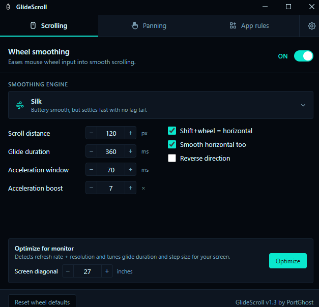
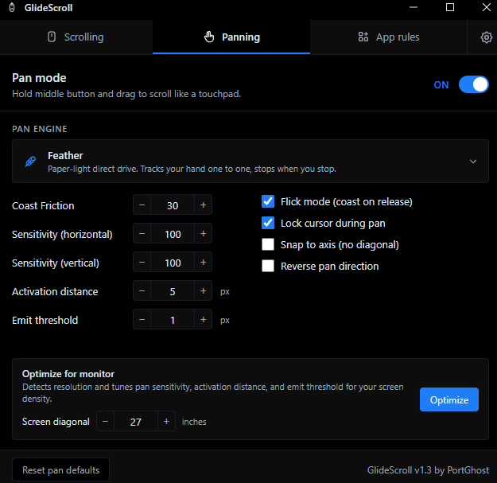
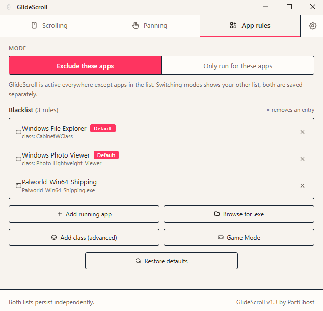
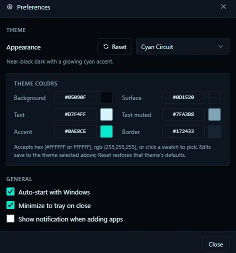

# GlideScroll

Smooth wheel scrolling and middle-button pan for Windows, by PortGhost.



## What it does

- **Wheel smoothing.** Real wheel input is suppressed and replaced with a stream of synthetic wheel events that ease over a configurable animation window. Six interchangeable smoothing engines, each tuned for a different feel, pick from a dropdown in the Scrolling tab.
- **Middle-button pan.** Hold the middle mouse button and drag, like a touchpad. Two pan engines: Feather (direct 1:1 drive, page sticks to your hand) and Cushion (damped, with a smoothing filter). Release with flick mode on for kinetic coast that decays via configurable friction.
- **Game Mode.** GlideScroll pauses itself while the window under your cursor belongs to a game, and resumes the instant you are back on a normal window. Detection is layered (known game exes, anti-cheat runtimes, fullscreen corroboration) and external: GlideScroll never touches a game's process, memory, or modules, only window geometry, process names, service status, and files on disk. Multi-monitor aware: a browser on the second screen stays smooth while a game runs on the first.
- **Per-app control.** Exclusion list ("run everywhere except these") or inclusion list ("only run for these"). Both lists persist independently, so switching modes never loses your work. Add apps by picking from running apps, browsing for an exe, or pointing at a window. Right-click the tray icon to instantly disable for the foreground app.
- **Theming.** Auto / Light / Dark plus twelve more built-in palettes and three Custom slots. Every theme is editable from a six-color picker with hex / rgb input; per-theme reset restores factory colors.
- **Optimize for monitor.** One-click tunes glide duration and step size from your refresh rate, native resolution, and physical screen diagonal, with per-engine sweet spots.

| Panning | App rules | Theme editor |
|---|---|---|
|  |  |  |

## Smoothing engines

Display names as they appear in the UI, with the class that implements each:

| Engine | Class (`Pipeline/Smoothers.cs`) | Feel |
|---|---|---|
| Liquid Glide | `SpringSmoother` | 2nd-order spring, glides with inertia and configurable bounce |
| Silk (default) | `SilkSmoother` | Online minimum-jerk trajectory; buttery but settles in bounded time, no lag tail |
| Cadence | `CadenceSmoother` | Input-rate adaptive: crisp on slow notches, momentum on fast flicks |
| Smoothed Notch | `HybridSmoother` | Stock-style steps with smoothed transitions |
| Notch with Glide | `FlywheelSmoother` | Stock-style steps with a mild exponential-decay glide |
| Low Latency | `LowLatencySmoother` | Minimal lerp per notch, fastest response |

All engines share the same contract (`ISmoother`: UpdateConfig / EnqueueNotch / Tick / Reset) and the same design rules: instant direction-reversal (no coast-through-zero), sub-pixel residual accumulation, and lock-protected state shared between the hook thread and the timer thread.

## Architecture

```
WH_MOUSE_LL hook  ──►  ScrollPipeline.HandleEvent  ──►  routing
                              │                           │
                       GamePauseGate ◄────────────────────┤ (consulted per event)
                              │                           │
                          ┌───┴───────────┬───────────────┴───┐
                          │               │                   │
                       Wheel?         Middle button?      Other input?
                          │               │                   │
              Active ISmoother    PanStateMachine         CancelCoast
              (one per axis)      ┌───────┴───────┐
                          │       │               │
                          │   Click path     Pan/coast path
                          │       │               │
                          │   replay click   PanController
                          │                  (Feather / Cushion)
                          │                       │
                          └────────►  InputSynth  ◄──┘
                                  (SendInput, magic-tagged)
```

- A dedicated background thread (`ScrollPipeline.TimerLoop`) ticks both pipelines at the display's refresh rate (clamped 60-360 Hz) so emit cadence aligns with vsync; a fixed rate would alias against common refresh rates and micro-stutter. `timeBeginPeriod(1)` raises system timer resolution while running.
- All synthetic events are tagged via `dwExtraInfo` so the hook recognises its own output and never re-processes it.
- The hook thread's hot path is allocation-free. Foreground-exe and window-class lookups are cached (~150 ms / ~120 ms) so per-event cost in the steady state is a couple of reads.
- Game Mode's decision is anchored to the window under the cursor and cached per hwnd; in-flight motion is flushed if the cursor ends up over a paused target, so a glide can never dribble into a game.
- Single-instance enforced via a per-user named mutex.
- The settings window is a single HTML/CSS/JS page (`UI/WebUI.cs`) rendered in WebView2; all persistent state lives on the C# side and the page is a thin renderer communicating over `postMessage`.

## File layout

```
GlideScroll/
├── GlideScroll.sln
├── GlideScroll.csproj         # net8.0-windows, single-file Release publish
├── app.manifest               # PerMonitorV2 DPI awareness, asInvoker
├── Program.cs                 # entry point, mutex single-instance
├── Native/
│   ├── Win32.cs               # P/Invoke definitions, structs, magic value
│   ├── MouseHook.cs           # WH_MOUSE_LL wrapper, MouseEvent dispatch
│   ├── InputSynth.cs          # SendInput wrappers (wheel, click)
│   ├── WindowEnumerator.cs    # foreground/visible-window enumeration
│   ├── WindowTargeting.cs     # point-at-a-window finder support
│   └── CustomPopupMenu.cs     # frameless tray context menu (owner-drawn)
├── Pipeline/
│   ├── ScrollPipeline.cs      # top-level orchestrator + timer thread
│   ├── ISmoother.cs           # engine contract + SmoothingMath helpers
│   ├── Smoothers.cs           # the six wheel-smoothing engines
│   ├── PanController.cs       # Feather / Cushion pan + coast
│   ├── PanStateMachine.cs     # middle-button click/pan disambiguation
│   └── GamePauseGate.cs       # Game Mode detection + pause decision
├── Config/
│   ├── AppConfig.cs           # JSON-persisted settings (LocalAppData)
│   ├── Autostart.cs           # HKCU Run registry helper
│   ├── DisplayInfo.cs         # refresh-rate + resolution detection, per-engine tuning
│   └── SystemTheme.cs         # Windows light/dark detection
└── UI/
    ├── MainForm.cs            # frameless host window for the WebView2 page
    ├── WebUI.cs               # the settings page (HTML/CSS/JS as a C# raw string)
    ├── TrayContext.cs         # NotifyIcon + ApplicationContext host
    ├── CaptureTooltip.cs      # follow-cursor label for the finder tools
    └── WebViewWarmup.cs       # WebView2 pre-warm at startup
```

## Build

Requires the .NET 8 SDK (free from Microsoft). Tested targets: Windows 10 22H2, Windows 11.

```powershell
# Debug build (development)
dotnet build

# Release build, single self-contained compressed EXE (~46MB)
dotnet publish -c Release -r win-x64 --self-contained true `
  -p:PublishSingleFile=true `
  -p:IncludeNativeLibrariesForSelfExtract=true `
  -p:EnableCompressionInSingleFile=true
# Output: bin/Release/net8.0-windows/win-x64/publish/GlideScroll.exe
```

## Install / autostart

1. Copy the published `GlideScroll.exe` somewhere stable (e.g. `C:\Tools\GlideScroll\`).
2. Run it once. Tray icon appears.
3. Open Settings (double-click the tray icon), gear icon, check **Auto-start with Windows**. The autostart registry entry self-heals if the EXE moves.
4. If SmartScreen flags the EXE, that is a false positive common to single-file .NET executables that install low-level hooks; add a Defender exclusion for the EXE path.

Config lives at `%LOCALAPPDATA%\GlideScroll\config.json`. Deleting it restores factory defaults on next start. See the included user guide for a full tour.

## License

GlideScroll is source-first software: the code is public for personal use, study, and modification, but commercial use and paid redistribution are not permitted. See [LICENSE.md](LICENSE.md) for the exact terms and [THIRD-PARTY-NOTICES.txt](THIRD-PARTY-NOTICES.txt) for the licenses of bundled components (WebView2 SDK, .NET runtime, Tabler Icons).

Pull requests are not accepted; see [CONTRIBUTING.md](CONTRIBUTING.md). Bug reports in Issues are very welcome.

## Known limitations

- **Per-app parameter overrides** (different smoothness in browser vs PDF viewer) are not wired up; App rules currently control only whether GlideScroll affects an app.
- **Foreground app detection** uses a short-cached poll (~150 ms). A `WinEventHook` on `EVENT_SYSTEM_FOREGROUND` would be more exact; polling has proven fine in practice.
